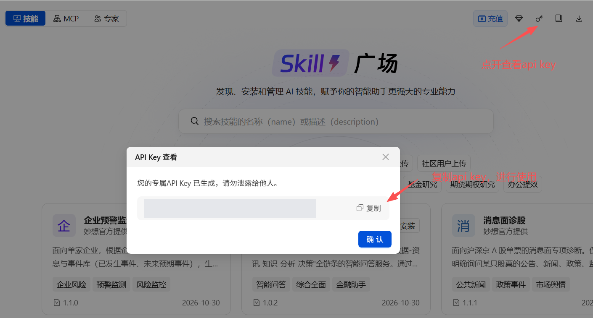

# EastmoneyMCP · Eastmoney Miaoxiang MCP

[简体中文](./README.md) · **English**

**Query financial data, retrieve financial information, and screen instruments through natural language with your AI agent.**

Miaoxiang MCP connects agents to Eastmoney data services through the Model Context Protocol. It provides equity, fund, bond, index, macroeconomic, and industry data, together with announcement, research report, and news retrieval. This repository contains capability descriptions, examples, and connection guidance.

🌐 [Official website](https://ai.eastmoney.com/skills) · 📘 [Configuration guide](./docs/mcp-install.md) · 🧩 [EastmoneySkills](https://github.com/ai-eastmoney/EastmoneySkills)

## 🚀 Connect with your agent

Send this request to an agent that supports MCP and can configure connections:

```text
Configure the Miaoxiang MCP Server according to:
https://mxapi.eastmoney.com/mxds/doc/mcp-install.md
Prefer curl to retrieve the document.
Do not expose the API key in terminal output, logs, or chat.
```

The agent can follow the guide to identify your client, configure the connection, and check tool availability. Some clients require a reload, restart, or manual trust confirmation.

To read the guide without configuring anything:

```bash
curl -fsSL https://mxapi.eastmoney.com/mxds/doc/mcp-install.md
```

### Connection details

| Setting | Value |
| --- | --- |
| Server name | `mx-ds-mcp` |
| Endpoint | `https://mxapi.eastmoney.com/mxds/mcp` |
| Transport | Streamable HTTP |
| Authentication header | `em_api_key` |
| API key acquisition | [Miaoxiang Skills website](https://ai.eastmoney.com/skills) |

The configuration guide covers Claude Code, WorkBuddy, Codex, OpenClaw (including Miaoxiang Claw), Cursor, Hermes Agent, Trae, and QClaw, with generic instructions for other clients. Follow your client's current documentation alongside the guide.

## 🔑 Get your API key

1. Sign in at the [Miaoxiang Skills website](https://ai.eastmoney.com/skills).
2. Click the key icon in the upper-right corner to open the API key dialog.
3. Click “复制” (Copy) and configure the key locally. The configuration process can read an existing `EM_API_KEY` environment variable.



Use the key only for local authentication configuration. Keep it out of public repositories, Issues, terminal logs, and chat. Where supported, use the client's documented environment-variable configuration mechanism.

## 📊 Financial capabilities

| Capability | Data | Example |
| --- | --- | --- |
| A-shares | Profiles, prices, financials, valuation, technicals, shareholders, and company events | Latest reported revenue and net profit for Kweichow Moutai |
| Hong Kong and US equities | Profiles, prices, financials, valuation, shareholders, buybacks, and dividends | Apple and Tesla price changes over the last 10 trading days |
| Funds | NAV, returns, risk, shares, asset allocation, and holdings | A fund's latest reported top ten holdings |
| Bonds | Issuance, payments, quotes, valuation, duration, convexity, issuer financials, and ratings | Issue size and tenor of a specified bond |
| Indices and sectors | Prices, technicals, financial valuation, and constituent aggregates | CSI 300 closing levels over the last 10 trading days |
| Macro and industry | GDP, CPI, financing, money, trade, and commodity or industry indicators | China's monthly CPI year-on-year over the last 12 months |
| News and research | News, analyst views, ratings, forecasts, and industry trends | Semiconductor research views published in the last month |
| Announcements | Company announcements, periodic reports, exchange and regulatory disclosures | CATL's latest dividend announcements |
| Screening | Filter or rank stocks, funds, ETFs, convertible bonds, domestic futures, sectors, and other supported entities | Find the 20 profitable A-share companies with the lowest P/E ratios |
| Comprehensive data | Enterprises, unlisted companies, and other or cross-market instruments | Huawei Technologies company profile |

Examples illustrate request formats. Results depend on service permissions, instrument coverage, and update times. Specify subjects, metrics, time ranges, and definitions to help the agent choose tools.

## 🧰 Tools

| Tool | Purpose |
| --- | --- |
| `mx_ashare_finance_data` | A-share data |
| `mx_hk_finance_data` | Hong Kong equity data |
| `mx_us_finance_data` | US equity data |
| `mx_fund_finance_data` | Fund data |
| `mx_bond_finance_data` | Bond data |
| `mx_index_block_finance_data` | Index and sector data |
| `mx_comprehensive_finance_data` | Other instruments, enterprises, and comprehensive queries |
| `mx_macro_data` | Macro, industry, and commodity indicators |
| `mx_finance_search_news` | News, research reports, and institutional views |
| `mx_finance_search_notice` | Announcements and official disclosures |
| `mx_stocks_screener` | Screening and ranking |

This list reflects the 11 currently visible Miaoxiang MCP tools. Clients may prefix tool names with the server identifier. Securities data tools support up to 500 instruments or entities per request. Each screening query covers one instrument type; split requests that span multiple types. Tools and coverage may change as the service evolves.

## 🧩 Use with Skills

[EastmoneySkills](https://github.com/ai-eastmoney/EastmoneySkills) provides diagnosis, research, and report workflows. Miaoxiang MCP supplies callable data and retrieval tools. Query directly through MCP or connect these tools to a workflow as specified by the selected skill.

Some research skills also require a separate MQL MCP, Choice SDK, or document-generation environment. Configuring `mx-ds-mcp` does not install all skills or configure all research dependencies.

## 💬 FAQ

**Do I need to download this repository?**

No. This repository provides documentation for a remote service. You do not need to deploy a server program from this repository locally.

**What if no tools appear after setup?**

Check Streamable HTTP support, saved configuration, and whether the client needs a reload or trust confirmation. Then check authentication and connectivity using the official guide.

**What if tools appear but queries fail?**

Check the key, data permissions, and request scope. Share client details, tool names, and redacted errors when reporting a problem; never include credentials.

## 🤝 Feedback

Use [Issues](https://github.com/ai-eastmoney/EastmoneyMCP/issues) for connection documentation issues and feedback. Include the client version, operating system, reproducible request, and redacted errors.

## 📄 Rights and usage

Copyright in this repository's contents belongs to Eastmoney. Installation and use are subject to applicable license and service terms. Copying, redistribution, or commercial use beyond those permissions requires prior authorization from Eastmoney.

Data and retrieved materials remain subject to source-provider permissions. Results assist information organization and research and do not constitute investment advice. Verify timestamps, sources, and calculation definitions before making decisions.
