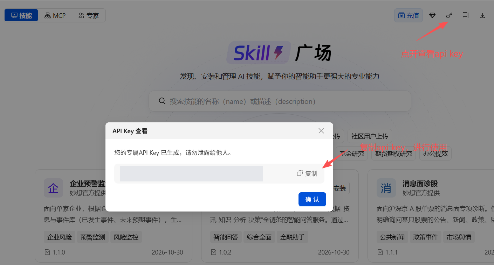

# EastmoneyMCP · 东方财富妙想 MCP

**简体中文** · [English](./README.en.md)

**让 AI Agent 用自然语言查询金融数据、检索财经资讯与筛选标的。**

妙想 MCP 通过标准 MCP 协议连接东方财富数据服务，提供股票、基金、债券、指数板块、宏观产业数据，以及公告、研报和新闻检索能力。本仓库提供能力介绍、使用示例与接入指南。

🌐 [妙想官网](https://ai.eastmoney.com/skills) · 📘 [官方配置文档](https://mxapi.eastmoney.com/mxds/doc/mcp-install.md) · 🧩 [EastmoneySkills 技能库](https://github.com/GraceXiaoo/EastmoneySkills)

📂 [查看仓库内配置文档](./docs/mcp-install.md)（下载自官方地址，2026-10-31；最新内容以在线文档为准）。

## 🚀 一键接入

在支持 MCP 和配置操作的 Agent 中发送：

```text
帮我按照 https://mxapi.eastmoney.com/mxds/doc/mcp-install.md
来配置妙想 MCP Server（优先使用 curl 拉取文档）。
不要在终端、日志或对话中输出 API Key。
```

Agent 可按官方文档识别客户端、配置连接并检查工具是否可用。配置后，部分客户端需要重新加载、重启或在界面中信任连接。

只想先查看文档，可运行：

```bash
curl -fsSL https://mxapi.eastmoney.com/mxds/doc/mcp-install.md
```

### 连接信息

| 项目 | 配置 |
| --- | --- |
| 服务名称 | `mx-ds-mcp` |
| 服务地址 | `https://mxapi.eastmoney.com/mxds/mcp` |
| 传输协议 | Streamable HTTP |
| 认证请求头 | `em_api_key` |
| 密钥获取 | [妙想 Skills 官网](https://ai.eastmoney.com/skills) |

官方配置文档涵盖 Claude Code、WorkBuddy、Codex、OpenClaw（含妙想 Claw）、Cursor、Hermes Agent、Trae、QClaw，并提供其他客户端的通用接入指引。具体配置请结合客户端当前版本与官方文档执行。

## 🔑 获取 API Key

1. 登录 [妙想 Skills 官网](https://ai.eastmoney.com/skills)。
2. 点击右上角钥匙图标，打开“API Key 查看”。
3. 点击“复制”，在本地配置使用；已有 `EM_API_KEY` 环境变量时，可由配置流程读取。



密钥仅用于本地认证配置，不应写入公开仓库、Issue、终端日志或对话。支持环境变量引用的客户端应使用其官方支持的配置方式。

## 📊 金融能力

| 能力 | 可以查询什么 | 示例 |
| --- | --- | --- |
| A 股 | 基本资料、行情、财务估值、技术指标、股东与公司事件 | 贵州茅台最近一期营收和净利润 |
| 港股与美股 | 公司资料、行情、财务、估值、股东、回购与分红 | 苹果和特斯拉近 10 个交易日涨跌幅 |
| 基金 | 净值、收益、风险、份额、资产配置与持仓 | 查询这只基金最近一期前十大重仓股 |
| 债券 | 发行兑付、报价估值、久期凸性、发行人财务与评级 | 查询 23广东11 的发行期限与发行总额 |
| 指数与板块 | 行情、技术指标、财务估值及成分股聚合指标 | 沪深300 过去 10 个交易日收盘点数 |
| 宏观与产业 | GDP、CPI、社融、货币、贸易及商品产业量价数据 | 查询中国近 12 个月 CPI 同比 |
| 资讯与研报 | 新闻、研究观点、评级、预测和产业趋势 | 检索近一个月半导体行业研报观点 |
| 公告与披露 | 公司公告、定期报告、交易所与监管披露 | 查找宁德时代最近的分红公告 |
| 条件筛选 | 按条件或排序找股票、基金、ETF、可转债、国内期货和板块等 | 筛选 A 股市盈率最低的 20 只盈利公司 |
| 综合取数 | 企业、非上市公司及其他或跨市场品种 | 查询华为技术有限公司的企业基本资料 |

以上示例用于说明查询方式，实际数据取决于服务权限、标的覆盖与数据更新时间。查询时说明对象、指标、时间范围和统计口径，可帮助 Agent 选择工具。

## 🧰 工具清单

| 工具 | 用途 |
| --- | --- |
| `mx_ashare_finance_data` | A 股结构化数据 |
| `mx_hk_finance_data` | 港股结构化数据 |
| `mx_us_finance_data` | 美股结构化数据 |
| `mx_fund_finance_data` | 基金结构化数据 |
| `mx_bond_finance_data` | 债券结构化数据 |
| `mx_index_block_finance_data` | 指数与板块结构化数据 |
| `mx_comprehensive_finance_data` | 其他品种、企业及综合查询 |
| `mx_macro_data` | 宏观、产业和商品指标 |
| `mx_finance_search_news` | 新闻、研报与机构观点检索 |
| `mx_finance_search_notice` | 公告与官方披露检索 |
| `mx_stocks_screener` | 条件筛选与排名 |

工具清单依据当前可见的 11 个妙想 MCP 工具整理，客户端可能为工具名添加服务前缀。各证券数据工具单次最多处理 500 个标的或实体；筛选请求每次只覆盖一个品种，多品种需求应拆分调用。服务更新可能调整工具及范围。

## 🧩 与 Skills 配合

[EastmoneySkills](https://github.com/GraceXiaoo/EastmoneySkills) 提供诊断、研究和报告工作流；妙想 MCP 提供可供 Agent 调用的数据与检索工具。可以直接使用 MCP 查询，也可以按所选 Skill 的说明将工具接入研究流程。

部分研究 Skill 还需要独立的 MQL MCP、Choice SDK 或文档生成环境。配置 `mx-ds-mcp` 不等于已安装所有 Skills 或配置好所有研究依赖。

## 💬 常见问题

**需要下载本仓库才能使用吗？**

不需要。本仓库是介绍与接入文档，实际连接的是远程 MCP 服务，无需在本机部署本仓库中的服务端程序。

**连接后没有工具怎么办？**

检查客户端是否支持 Streamable HTTP、配置是否保存、是否需要重新加载或信任连接，再按官方文档检查认证与网络。

**工具可见，但查询失败怎么办？**

检查 API Key、数据权限和请求范围。反馈时提供客户端、工具名称与脱敏报错，不要提供密钥。

## 🤝 反馈

通过 [Issues](https://github.com/GraceXiaoo/EastmoneyMCP/issues) 提交接入文档问题或使用反馈。请附客户端版本、操作系统、可复现问句及脱敏错误信息。

## 📄 版权与使用

本仓库内容的版权归东方财富所有。安装与使用请遵循相关许可说明及服务条款；超出许可范围的复制、再分发或商业使用，须事先获得东方财富授权。

数据与检索材料的使用受相应来源授权约束。查询结果用于信息整理与研究辅助，不构成投资建议；决策前应核验数据时点、来源与计算口径。
